# mermaid height check

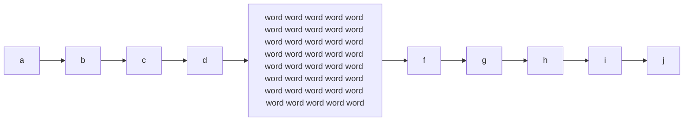

P-flow-wide

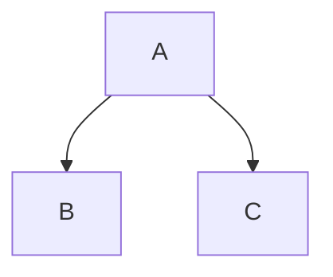

P-flow-narrow

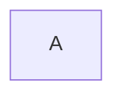

P-flow-tiny

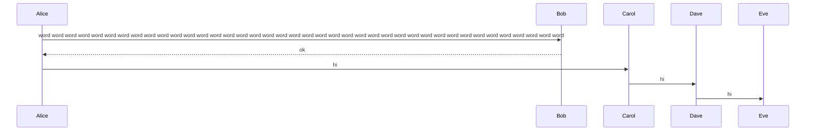

P-sequence

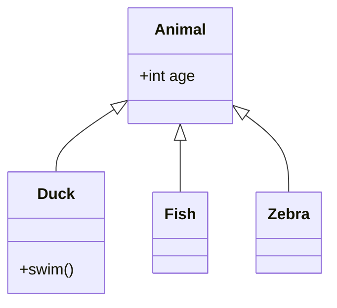

P-class

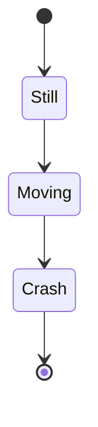

P-state

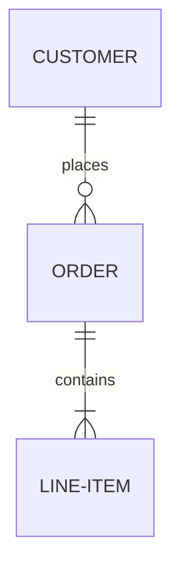

P-er

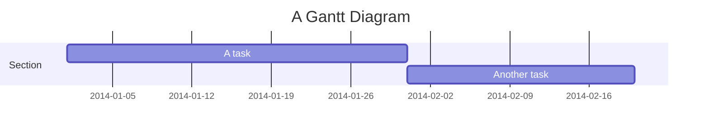

P-gantt

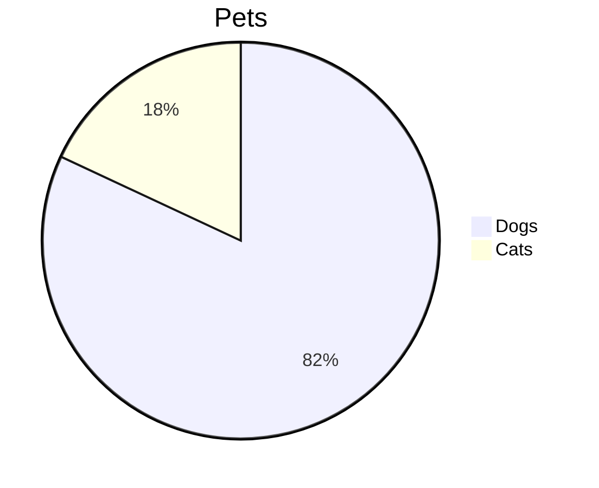

P-pie

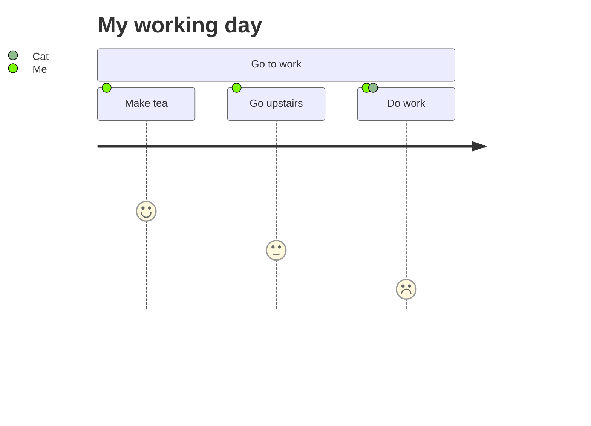

P-journey

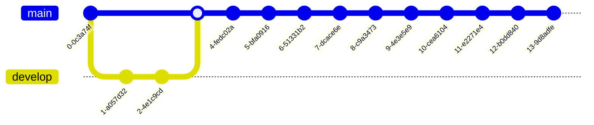

P-gitgraph

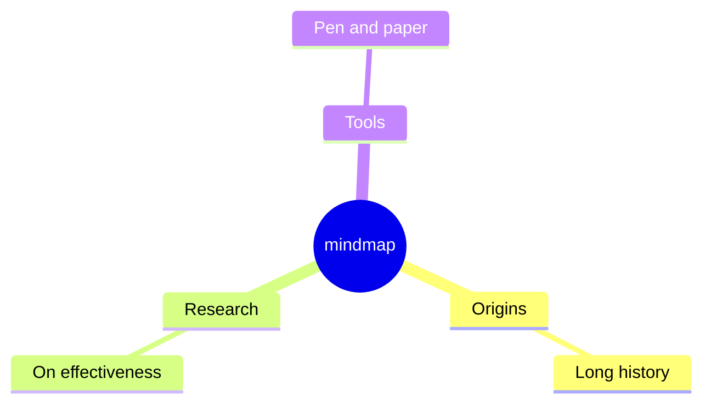

P-mindmap

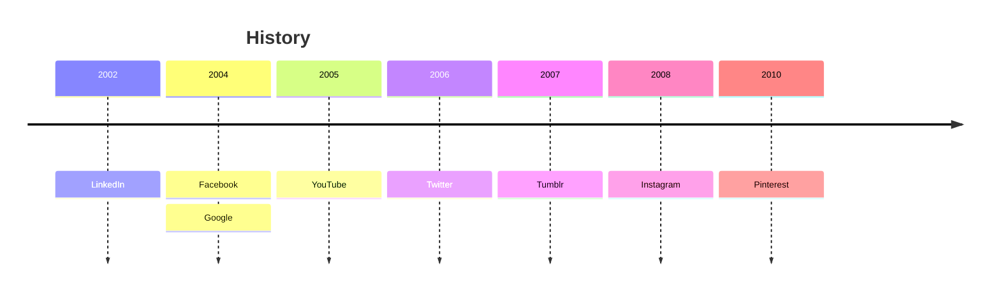

P-timeline

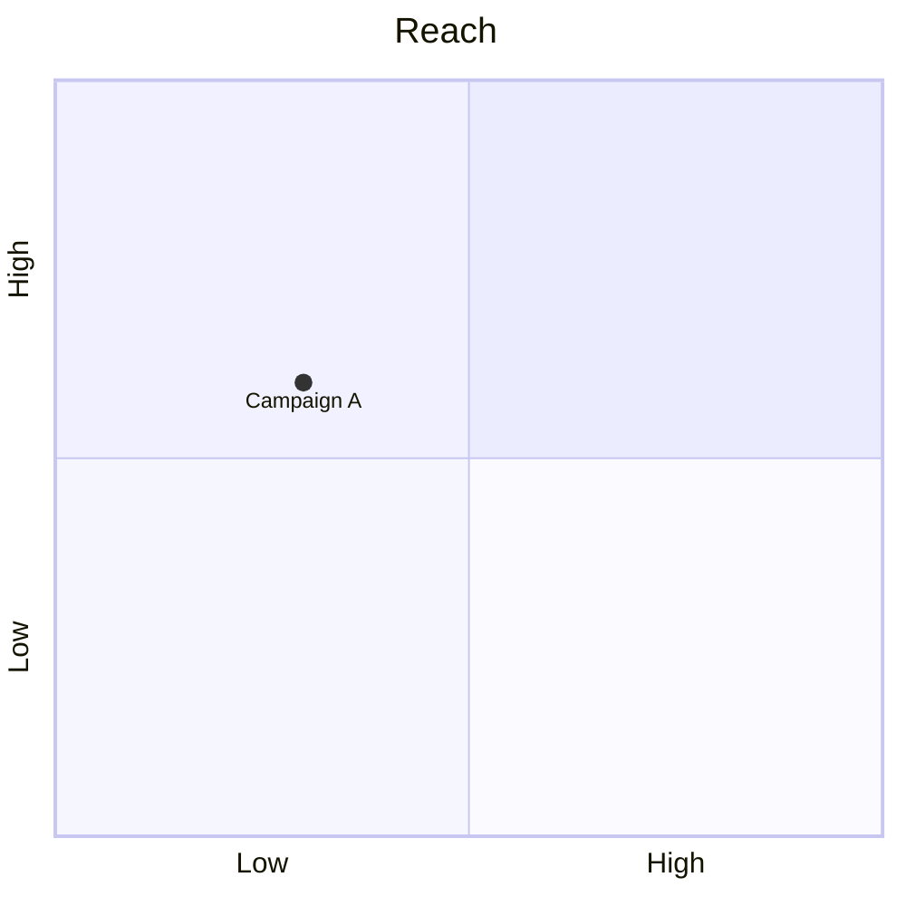

P-quadrant

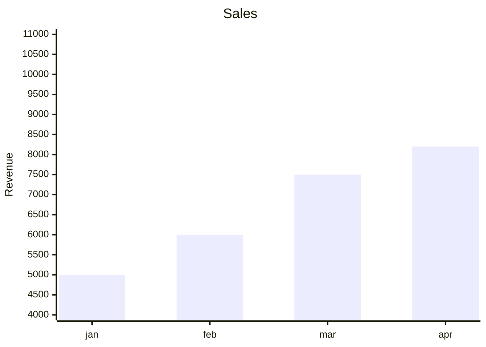

P-xychart

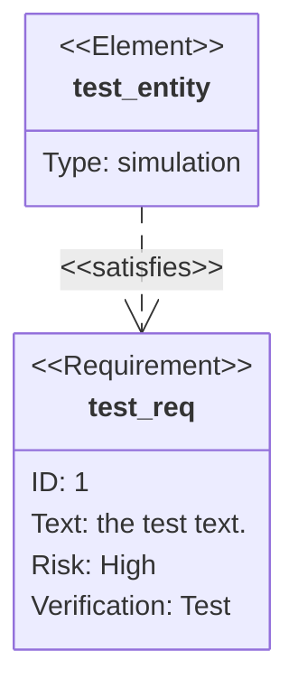

P-requirement

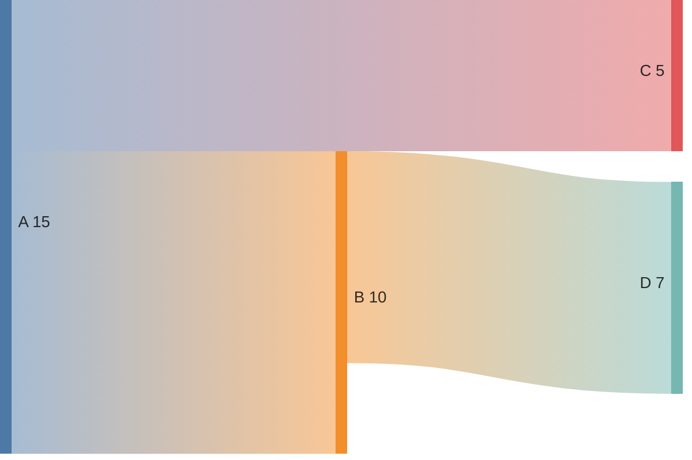

P-sankey

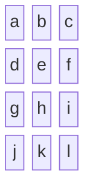

P-block

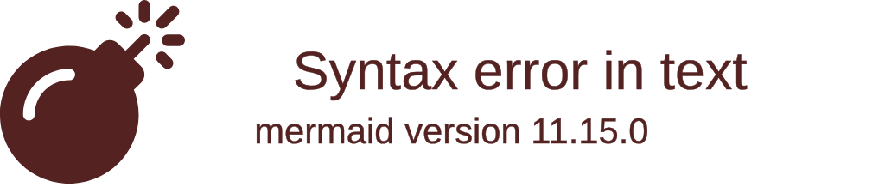

P-packet

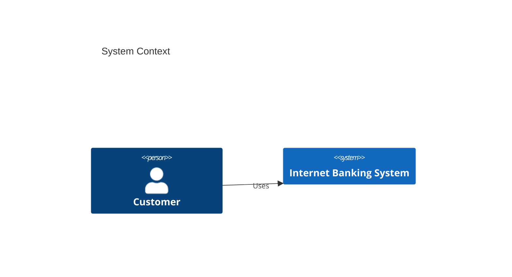

P-c4

```mermaid
architecture-beta
  group api(cloud)[API]
  service db(database)[Database] in api
  service server(server)[Server] in api
  db:L -- R:server
```

P-architecture

```mermaid
kanban
  Todo
    id1[Create docs]
  Done
    id2[Ship it]
```

P-kanban

```mermaid
radar-beta
  axis A, B, C
  curve c1{1, 2, 3}
```

P-radar

```mermaid
treemap-beta
"Section 1"
    "Leaf 1.1": 12
    "Leaf 1.2": 6
"Section 2"
    "Leaf 2.1": 3
```

P-treemap

